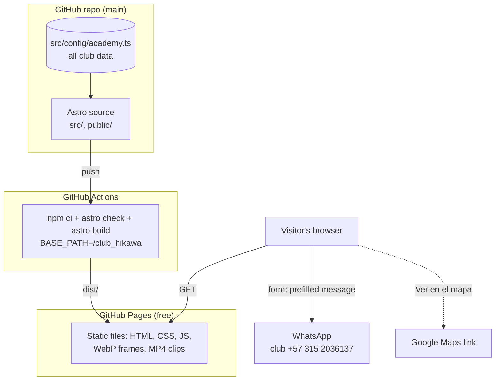
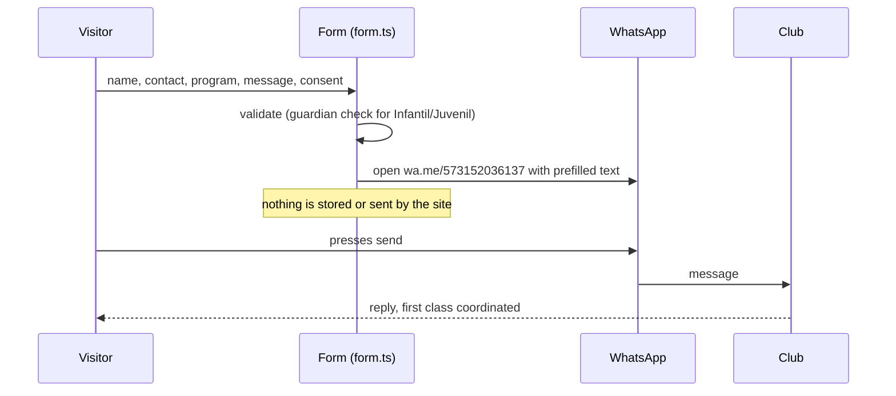
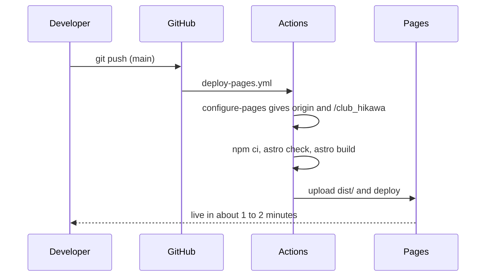

# Club Hikawa

Website for the **Club Deportivo de Judo Hikawa**, a judo club in Cali, Valle del Cauca, Colombia. The site presents the club, its four programs (Infantil, Juvenil, Adultos, Competición) and judo itself, and turns visitors into enrolment requests: a short form composes a message and opens WhatsApp to the club. A signature scroll-controlled judo throw opens the home page.

**Live:** https://donatonicolasayalaosorio73.github.io/club_hikawa/

The site is static, with no backend, no database, no cookies and no analytics, and costs $0 to host. The site content is in Spanish. This document is in English.

**Contents:**
1. [Architecture at a glance](#architecture-at-a-glance)
2. [Key flows](#key-flows)
3. [Repository layout](#repository-layout)
4. [Where new code goes](#where-new-code-goes)
5. [Pages and features](#pages-and-features)
6. [Stack](#stack)
7. [Club data](#club-data)
8. [Legal and privacy](#legal-and-privacy)
9. [Security](#security)
10. [Quality](#quality)
11. [Decisions and tradeoffs](#decisions-and-tradeoffs)
12. [Local setup](#local-setup)
13. [Environment variables](#environment-variables)
14. [Deployment](#deployment)
15. [Known limitations and next steps](#known-limitations-and-next-steps)
16. [License and credits](#license-and-credits)

## Architecture at a glance

The paradigm is **static site, the visitor's own WhatsApp as the backend**:

- **At build time** Astro renders every page to plain HTML from one data file, `src/config/academy.ts`.
- **In the browser** a few small TypeScript modules add motion (GSAP ScrollTrigger), the mobile menu and form validation.
- **Enrolment** never touches a server: the form builds a message and opens `wa.me` on the visitor's device. Nothing reaches the club until the visitor presses send in WhatsApp.



| Piece | Where | Responsibility |
| --- | --- | --- |
| Pages | `src/pages/` | Home, El judo, Privacy policy, Terms of use |
| Components | `src/components/` | One component per section of a page |
| Club data | `src/config/academy.ts` | Every fact about the club: contact, address, programs, schedules, sensei, legal details |
| Client scripts | `src/scripts/` | Header and menu behaviour, the hero frame sequence, the enrolment form |
| Media | `public/` | Hero frames (WebP), looping clips (MP4), posters, logo |
| Hosting | GitHub Pages | Serves `dist/` under `/club_hikawa/` |

## Key flows

**An enrolment request:**



If no WhatsApp number or email is configured, the form says plainly that it is not connected and shows the message it would have sent. It never fakes success.

**A deploy:**



## Repository layout

```
.
├── src/
│   ├── pages/                  One file per URL
│   │   ├── index.astro           / : hero, programs, practical info, FAQ, join band, form
│   │   ├── el-judo.astro         /el-judo/ : philosophy, techniques, training, grades, sensei
│   │   ├── privacidad.astro      /privacidad/ : personal data policy (Ley 1581 de 2012)
│   │   └── terminos.astro        /terminos/ : terms of use and legal notice
│   ├── layouts/
│   │   ├── Base.astro            <head>, meta and Open Graph tags, fonts, global CSS
│   │   └── Legal.astro           Shared shell for the legal pages
│   ├── components/             One component per section
│   │   ├── Header.astro, Footer.astro, Loader.astro, LogoMark.astro
│   │   ├── HeroSequence.astro    Scroll-scrubbed throw (canvas + frame sequence)
│   │   ├── Programs.astro, Schedule.astro, Info.astro, Faq.astro
│   │   ├── Join.astro, Registration.astro
│   │   └── Values.astro, Techniques.astro, Performance.astro, Grades.astro, Sensei.astro
│   ├── config/
│   │   ├── academy.ts            All club data (see "Club data")
│   │   └── url.ts                withBase(): prefixes internal paths with the deploy sub-path
│   ├── scripts/
│   │   ├── site.ts               Header state, mobile menu, smooth in-page links, reveals, clips
│   │   ├── sequence.ts           Frame loading and drawing for the hero throw (GSAP ScrollTrigger)
│   │   └── form.ts               Form validation and the WhatsApp / email hand-off
│   └── styles/global.css       Design tokens (colour, type, spacing, motion) and base styles
│
├── public/
│   ├── frames/d/, frames/m/    120 desktop and 102 mobile WebP frames of the throw
│   ├── video/, posters/        Looping MP4 clips and their WebP posters
│   └── assets/                 Logo in several sizes
│
├── scripts/extract-frames.mjs  Extracts the frame sequence from a video through Edge or Chrome (no ffmpeg)
├── docs/legal/                 Enrolment form template: consent, data and image authorizations
├── .github/workflows/
│   └── deploy-pages.yml        Build and deploy to GitHub Pages on every push to main
├── astro.config.mjs            Static output; site and base come from the environment
└── package.json                Scripts and dependencies (Node 22.23.4 or later)
```

`media-src/` (source videos), `dist/`, `.astro/` and `node_modules/` are not committed.

## Where new code goes

| You are adding | Put it in | Remember |
| --- | --- | --- |
| A fact about the club (schedule, price, social link) | `src/config/academy.ts` | Leave a value empty rather than invent it: the page shows a "pending" marker |
| A section of a page | `src/components/` + import it in the page | Keep its existing `id`; other pages and old links point to section anchors |
| A new page | `src/pages/name.astro` | Use `Base` (or `Legal` for legal text), `Header` and `Footer`, and import `../scripts/site` |
| Any internal link or asset path | `withBase('/path')` from `src/config/url.ts` | A bare `"/path"` breaks under `/club_hikawa/` |
| Behaviour in the browser | `src/scripts/` | Respect `prefers-reduced-motion`; the content must work without JavaScript |
| Colour, type, spacing or motion values | Tokens in `src/styles/global.css` | Red `#E31B23` only for primary actions and accents |
| Legal text | `src/pages/privacidad.astro`, `terminos.astro` | Update `legal.policyDate` in `academy.ts` when the content changes |

## Pages and features

| Page | What it does |
| --- | --- |
| Inicio (`/`) | Intro loader with the club badge, full-screen scroll-scrubbed judo throw in six phases (kumikata to zanshin), programs with looping clips, practical information with schedules and a map link, FAQ, join band and the enrolment form |
| El judo (`/el-judo/`) | The dojo code (six principles with clips), six techniques, physical preparation, belt grades, the sensei |
| Política de privacidad (`/privacidad/`) | Short privacy notice plus the full personal data policy |
| Términos de uso (`/terminos/`) | Terms of use, sports risk notice, liability, intellectual property, applicable law |

Other features:
- **Enrolment form:** name, WhatsApp or email, program, optional message, required data-processing consent, and a required guardian confirmation for the youth programs.
- **Pending markers:** any club fact not provided yet appears as a dashed "[POR CONFIRMAR]" label instead of an invented value.
- **Old links keep working:** anchors of sections moved from the home page to `/el-judo/` redirect there.
- **Mobile first:** held stages use `100lvh`, readable content stays inside `100svh`, so the phone address bar never makes the page jump.
- **Accessibility:** skip link, keyboard menu with Escape, live region for form results, reduced-motion support, contrast ratios noted next to each colour token.

## Stack

| Technology | Use | Reason |
| --- | --- | --- |
| Astro 7 (static output) | Pages and components rendered to HTML at build time | No server to run or pay for; fast first load |
| TypeScript (strict) | Config, client scripts, `astro check` | Mistakes caught at build time |
| GSAP 3 + ScrollTrigger | Scroll-scrubbed hero sequence, pinned scenes | Reliable scroll-linked motion on phones and desktops |
| Vanilla CSS with custom properties | Design tokens and component styles | No UI framework needed for a content site |
| @fontsource Bebas Neue and Inter (variable) | Display and text fonts, self-hosted | No requests to Google Fonts, so no third-party tracking |
| WebP frames and MP4 clips | Hero sequence and section clips | Small files; the throw is drawn frame by frame on a canvas |
| GitHub Actions + GitHub Pages | Build and hosting | Free for public repos, HTTPS included, custom domain supported |

## Club data

Everything the site says about the club comes from `src/config/academy.ts`:

| Field | Current value |
| --- | --- |
| `name` | Club Deportivo de Judo Hikawa |
| `whatsappNumber` | +57 315 2036137 |
| `contactEmail` | Not provided yet |
| `address`, `city` | Cl. 9c Bis #46-139, Cali, Valle del Cauca |
| `mapsUrl` | https://maps.app.goo.gl/wwWNhT8iPRPbXvrH7 |
| `legal.nit`, `legal.representative` | Not provided yet (shown as pending in the privacy policy) |
| `legal.policyDate` | 28 de octubre de 2026 |
| `programs[].ages`, `.schedule` | Not provided yet |
| `firstClass`, `whatToBring`, `socials` | Not provided yet |
| `sensei` | Carlos Riascos; rank, philosophy and milestones not provided yet |

## Legal and privacy

The site follows Colombian law. **These texts are a well-founded draft, not legal advice: a lawyer in Colombia should review them before the club relies on them.**

| Document | Where | Covers |
| --- | --- | --- |
| Privacy notice and data policy | `/privacidad/` | Ley 1581 de 2012 and Decreto 1074 de 2015 (ch. 25): data controller, data collected, purposes, prior express consent, minors (guardian consent), sensitive data (health) and images, third parties (WhatsApp, GitHub Pages, Google Maps), data subject rights, query procedure (10 + 5 business days) and complaint procedure (15 + 8 business days), retention, cookies, validity |
| Terms of use | `/terminos/` | Purpose of the site (information only, no online contract), accuracy, judo is a contact sport with inherent risk, techniques are not to be practised unsupervised, liability limited only as far as Colombian law allows, intellectual property (Ley 23 de 1982, Decisión Andina 351), third-party links, applicable law |
| Consent in the form | `Registration.astro` | Checkbox authorizing data processing for the request, linked to the policy; guardian confirmation for minors |
| Enrolment form template | [docs/legal/formato-inscripcion.md](docs/legal/formato-inscripcion.md) | To print and sign at the dojo: athlete and guardian data, emergency contact, voluntary health declaration, informed consent and acceptance of risk, data processing authorization (including sensitive data), optional image authorization |

What protects the club in practice is the signed enrolment form, a medical fitness certificate and insurance, more than the website texts. A signed waiver does not exclude liability for gross negligence or intent (Colombian Civil Code, art. 1522).

Before relying on these documents, the club should:
1. Fill in `legal.nit`, `legal.representative` and `contactEmail` in `academy.ts`.
2. Have a lawyer review `/privacidad/`, `/terminos/` and the enrolment template.
3. Confirm its **reconocimiento deportivo** with the Secretaría del Deporte y la Recreación de Cali (Ley 181 de 1995, Decreto 1228 de 1995).
4. Take out accident and civil liability insurance for its athletes and activities.
5. Check whether it must register its databases in the **Registro Nacional de Bases de Datos** of the SIC (required for non-profits only above 100,000 UVT in total assets, Decreto 090 de 2018).
6. Collect and keep signed consent from every athlete, and from a guardian for every minor, before the first class.

## Security

| Control | Implementation |
| --- | --- |
| No attack surface | No server code, database, login or file upload; GitHub Pages serves static files over HTTPS |
| No personal data on the site | The form keeps nothing; data leaves the device only when the visitor sends the WhatsApp message |
| No tracking | No cookies, no localStorage, no analytics, no third-party fonts or scripts |
| External links | Open with `rel="noopener"` |
| Secrets | None. The build needs no keys; the deploy uses GitHub's built-in OIDC token |
| Supply chain | Dependencies pinned in `package-lock.json` and installed with `npm ci` |

## Quality

| Practice | State |
| --- | --- |
| Type checking | `astro check` runs before every build, locally and in CI; a type error fails the deploy |
| Build | `npm run build` must pass with 0 errors, 0 warnings, 0 hints |
| Browser checks | Every page checked in a real browser at phone (375 px) and desktop widths: no 404s, no console errors, no horizontal scroll, fonts and media loaded, sub-path links resolved |
| Design rules | Taste v2 "colour chapters" direction; tokens with checked contrast; no em or en dashes in site copy |
| Automated tests | None yet (see next steps) |

### AI-assisted engineering

| Tool | Use |
| --- | --- |
| Claude Code | Implementation, deploy setup, legal drafts, verification in the browser |
| Impeccable, Taste skill | Design direction and audits |
| BMad Method | Planning and review workflows |

Agents draft plans, code and text. Changes are checked with the build and in the browser before commit, and approved by a person.

## Decisions and tradeoffs

| Decision | Alternative considered | Gain | Cost |
| --- | --- | --- | --- |
| Static Astro site | WordPress or a site builder | Free hosting, nothing to patch, fast | Content changes need a code edit and a push |
| GitHub Pages | Azure Static Web Apps (Free) | $0, no card needed | Azure was blocked by the subscription's allowed regions (spaincentral, chilecentral, brazilsouth, mexicocentral, westus), none of which offer Static Web Apps. Pages has no custom headers and serves under a sub-path until a domain is added |
| | Azure Storage static website | Stays on Azure | Not free (small monthly cost) |
| `withBase()` for every internal path | Hard-coded root paths | Same build works under `/club_hikawa/` today and on a root domain later | Every new path must go through the helper |
| Form hands off to WhatsApp | A form backend (Formspree, a function, a database) | No server, no stored personal data, no cost; the club already uses WhatsApp | Depends on the visitor having WhatsApp; email is the fallback once configured |
| Frame sequence on a canvas | A scroll-controlled `<video>` | Exact, smooth scrubbing on every phone | About 6 MB of frames |
| Self-hosted fonts | Google Fonts | No third-party requests, simpler privacy policy | Font files in the bundle |
| Pending markers | Placeholder text that looks real | Never shows an invented price, schedule or address | Visible gaps until the club provides data |
| Legal pages on the site | Linking to a PDF | Indexable, accessible, same design | Must be kept in sync with `policyDate` |

## Local setup

Requirements: Node.js 22.23.4 or later, and npm.

```bash
npm install
```

```bash
npm run dev
```

Open http://localhost:4321. Locally the site runs at the root (`/`), not under `/club_hikawa/`.

| Command | Purpose |
| --- | --- |
| `npm run dev` | Development server with hot reload |
| `npm run check` | TypeScript and Astro checks |
| `npm run build` | `astro check` then production build to `dist/` |
| `npm run preview` | Serve `dist/` locally |
| `npm run frames` | Re-extract the hero frames from `media-src/` (needs Edge or Chrome) |

## Environment variables

| Variable | Scope | Purpose |
| --- | --- | --- |
| `SITE_URL` | Build (set by CI) | Absolute origin, used for the absolute `og:image` URL |
| `BASE_PATH` | Build (set by CI) | Sub-path the site is served under (`/club_hikawa`, or empty with a custom domain) |

Both come from `actions/configure-pages` in the workflow. Locally both are unset and the site builds for `/`. There are no secrets.

## Deployment

Every push to `main` deploys automatically through [.github/workflows/deploy-pages.yml](.github/workflows/deploy-pages.yml). To deploy by hand: **Actions → Deploy to GitHub Pages → Run workflow**.

One-time setup (already done): **Settings → Pages → Source: GitHub Actions**.

**Custom domain** (when the club has one):
1. **Settings → Pages → Custom domain**, enter the domain, enable **Enforce HTTPS**.
2. At the domain registrar, add the DNS records GitHub shows (a `CNAME` to `donatonicolasayalaosorio73.github.io` for a subdomain, or the four GitHub `A` records for an apex domain).
3. Push or re-run the workflow. `configure-pages` then reports an empty base path and the site builds for the root, with no code changes.

## Known limitations and next steps

- **Missing club data:** email, NIT, legal representative, schedules, ages, price or free first class, what to bring, social links, sensei details, real photos (Infantil and techniques). Until then the site shows pending markers.
- **Legal review:** the privacy policy, terms and enrolment template need review by a Colombian lawyer.
- **Sub-path URL:** the site lives at `github.io/club_hikawa/` until a custom domain is added.
- **No security headers:** GitHub Pages can't set headers such as `Content-Security-Policy`; a domain behind a CDN (for example Cloudflare's free plan) would allow them.
- **No automated tests:** add Playwright smoke tests (pages load, no 404s, form hand-off) to the workflow.
- **No 404 page:** add `src/pages/404.astro` with a link back home.

## License and credits

No license file is included: all rights reserved by the club. The club's name, logo and texts belong to the Club Deportivo de Judo Hikawa.

- Judo footage: Artem Podrez on [Pexels](https://www.pexels.com/video/men-doing-judo-6254569/), under the Pexels license.
- Fonts: Bebas Neue and Inter, SIL Open Font License.
